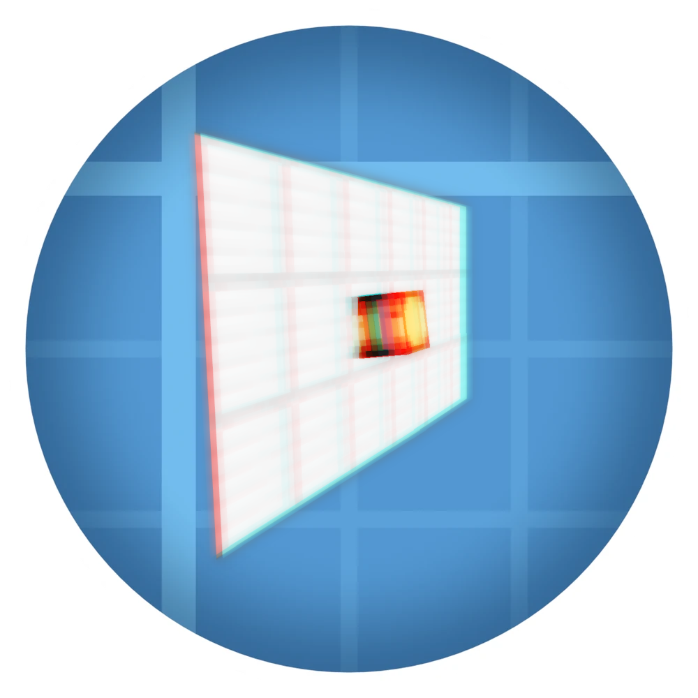

  

  <h1>Create Big Cannons Security Breach</h1>

  

    
    
    
    
  

  
A bridge mod that lets Create Big Cannons projectiles damage Security Craft reinforced blocks.

## Requirements

- Minecraft 1.21.1
- NeoForge 21.1.234 or newer
- Create Big Cannons 5.11.7 or newer
- Security Craft 1.10.1 or newer

## What it does

Security Craft blocks are normally immune to explosions. This mod gives them a Rust-style hit pool, so fortified blocks require sustained cannon fire before breaching:

- Each block has HP based on its material group (or custom per-block overrides).
- Deduplicated explosion damage (one hit per detonation using the strongest blast ray) and direct kinetic hits scale by velocity and munition type.
- Damaged blocks show the vanilla 10-stage break-progress overlay (persisted in world save data and synced automatically when loading chunks or reconnecting) plus impact/breach sounds and particles.
- **Create Engineer's Goggles HUD:** Wearing Create's Engineer's Goggles shows a live integrity overlay (HP, progress bar, material tier, owner, and repair hint) when looking at fortified blocks.
- **Manual Repair:** Owners can repair damaged blocks with `Shift + Right-Click` using configurable items (defaults: `create:wrench`, `minecraft:iron_ingot`).
- **Damage Decay:** Partially damaged blocks slowly recover over time (only in loaded chunks to prevent lag).
- **Admin Commands (`/cbcbreach`):** `inspect`, `clear <radius>`, `clearall`, `status`, and `reload`.

### Damage sources

- Cannon explosions (`ShellExplosion`, `ImpactExplosion`, `MortarStoneExplosion`) with separate multipliers for HE shells, AP shells, mortar stones, and drop mortars.
- Direct kinetic hits from big cannons (`AP Shot`, `AP Shell`, `Solid Shot`, `HE Shell`, `Mortar Stone`), autocannons, and `Grapeshot` / `Shrapnel` / `Flak` bursts.

### Material groups

- glass, powder (sand, gravel, dirt), wool, wood
- stone, copper, iron, gold, diamond, obsidian, steel, netherite

## Configuration

The server config file is created at `config/create_big_cannons_security_breach-server.toml` (and automatically synchronized with clients in multiplayer). It has eight sections:

- `general` - enable the mod, global explosion/direct hit multipliers, `dropBlocksOnBreak` (`false` by default for Rust-style PvP), ownable machine toggle, resistance override toggle.
- `munition_multipliers` - separate damage multipliers for HE, AP shell, AP shot, solid shot, mortar stone, drop mortar, autocannon, and shrapnel/grapeshot.
- `damage_decay` - post-hit grace period (`decayGracePeriodTicks`), crack healing interval (in ticks), percentage healed per step, and toggle.
- `repair` - manual repair toggle, owner-only restriction, HP per click, cooldown, allowed items, and item consumption toggle.
- `feedback` - Create Goggles HUD toggle, impact/breach particles, and sound effects.
- `material_hp` - HP for each material group and fallback.
- `material_resistance` - explosion resistance for each material group and fallback.
- `overrides` - `customBlockHp` (`modid:block=hp`) and `blacklistedBlocks`.

## License

Apache 2.0.
